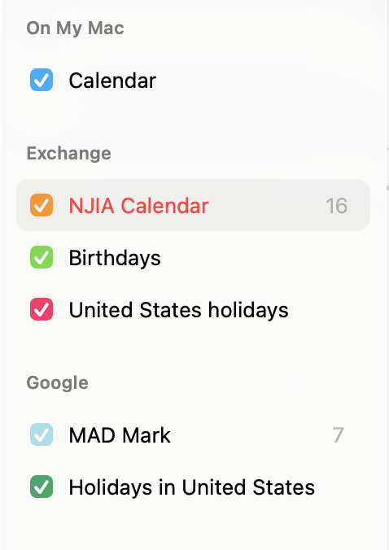

# Calendar Sync (Outlook ↔ Google, busy/free only)

Keeps your macOS-Calendar-based Outlook calendar and your macOS-Calendar-based
Google calendar mutually blocked. It never copies event titles, attendees,
locations, or descriptions — only opaque "🔒 Busy" placeholder events marking
the time as taken. This is what makes it safe to use even though your Outlook
calendar isn't allowed to be exported: no meeting content ever leaves either
system.

## 1. Add your Google account and Outlook account to Calendar.app, with syncing enabled

They should appear as calendars in Calendar.app's sidebar



## 2. Install the dependencies

Reading your calendars uses macOS's EventKit framework, which needs one Python
package. Install it into a virtualenv in this folder:

```bash
cd calendarsync
python3 -m venv .venv
.venv/bin/pip install -r requirements.txt
```

Use the virtualenv rather than `pip install --user`: both Homebrew's and
Apple's Python are marked as externally managed, and may refuse to install
into themselves. Everything from here on runs as `.venv/bin/python`, not
`python3`.

## 3. Configure the script

Run `.venv/bin/python eventkit_calendar.py` — it prints every Calendar.app
calendar's name, which account it comes from, and its stable internal id.
Two calendars can easily share a display name (an Exchange account's local
name keeps getting overwritten by the server's folder name, so your work
calendar is often just called "Calendar"), which is why this tool matches
calendars by id rather than by name.

Open `calendar_sync.py` and edit the CONFIG block near the top:

- `OUTLOOK_CALENDAR_ID` — the id of your Outlook calendar from the command above.
- `GOOGLE_CALENDAR_ID` — the id of your Google calendar from the command above.
- `OUTLOOK_CALENDAR_LABEL` / `GOOGLE_CALENDAR_LABEL` — display names used only in log output.
- `SYNC_WINDOW_DAYS` — how far ahead to keep synced (default 14).
- `OUTLOOK_OWNER_EMAIL` / `GOOGLE_OWNER_EMAIL` — your own address as it appears
  in each calendar's attendee lists, used to look up your RSVP status. Leave
  either as `""` to skip the lookup on that calendar. Case doesn't matter.
- `INCLUDE_DECLINED_EVENTS` / `INCLUDE_TENTATIVE_EVENTS` — whether meetings you
  declined (default: no) or marked tentative (default: yes) still block time on
  the other calendar. Needs the owner email above; see the caveat under
  "Notes / gotchas".

## 4. Run it once by hand

```bash
cd calendarsync
.venv/bin/python calendar_sync.py
```

The first run triggers one macOS permission prompt, **Calendars** ("Python
would like to access your calendars"). Approve it, and make sure you grant
*full* access — macOS also offers an "add events only" option, which is not
enough to read your events and fails with no error message at all. If you miss
the dialog, check System Settings > Privacy & Security > Calendars.

Run it by hand from Terminal the first time, not from launchd: macOS shows the
prompt to whatever launched the process, so a prompt raised under launchd may
never appear on screen.

To see what it *would* do without touching either calendar:

```bash
.venv/bin/python calendar_sync.py --dry-run
```

Check both calendars — you should see "🔒 Busy" placeholders appear for each
real event on the other side. Run it a second time and confirm it doesn't
duplicate them — it diffs by time against existing placeholders, so
unchanged events are left untouched and only moved/cancelled/new ones cause
a create or delete.

## 5. Automate it with launchd

1. Edit `com.you.calendarsync.plist`:
   - Replace `/Users/YOURNAME/calendar-sync/...` with the actual path to
     wherever you put this folder — in **both** the `.venv/bin/python` path
     and the `calendar_sync.py` path.
   - Adjust `StartInterval` (in seconds) if you want a different frequency
     — 10800 = every 3 hours. For once a day, use 86400, or switch to
     `StartCalendarInterval` for a fixed time (e.g. 7am) — see `man launchd.plist`.
2. Install it:
   ```bash
   cp com.you.calendarsync.plist ~/Library/LaunchAgents/
   launchctl load ~/Library/LaunchAgents/com.you.calendarsync.plist
   ```
3. Check `sync.log` in this folder after a bit to confirm it's running.

To stop it later:
```bash
launchctl unload ~/Library/LaunchAgents/com.you.calendarsync.plist
```

## Notes / gotchas

- **Google sync lag**: since Calendar.app syncs Google via Apple's own CalDAV
  refresh cycle (not a live API call), a newly created event on either side
  may take a few minutes to show up before this script can see it. Fine for
  a "block time on my calendar" use case.
- **All-day events** (e.g. "Out of office", holidays) are skipped by default,
  since they tend to be informational rather than real time blocks. Set
  `INCLUDE_ALL_DAY_EVENTS = True` in the CONFIG block to mirror them too.
- **Declined/tentative filtering is best-effort, not a guarantee.** With
  `INCLUDE_DECLINED_EVENTS = False`, a meeting you declined is skipped *only if*
  the calendar actually reports your RSVP as "declined". On an Exchange calendar
  most events instead report a status that isn't an RSVP answer at all, which
  the script treats as unknown and keeps rather than risk hiding a real
  commitment. So some declined meetings will still get a placeholder. The filters
  also do nothing on a calendar whose `*_OWNER_EMAIL` is left blank, since your
  status there can't be looked up at all.
- **Deleting the script's placeholders manually is safe** — the next run
  just recreates whatever's still needed (it diffs against real events, so
  nothing gets silently skipped).
- **Don't rename `PLACEHOLDER_PREFIX`** after the first run without manually
  cleaning up old placeholders created under the previous prefix, since the
  script uses it to identify (and safely delete) only its own events.
